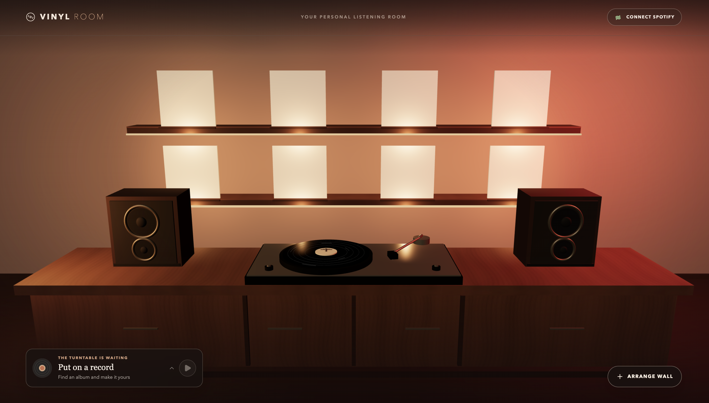
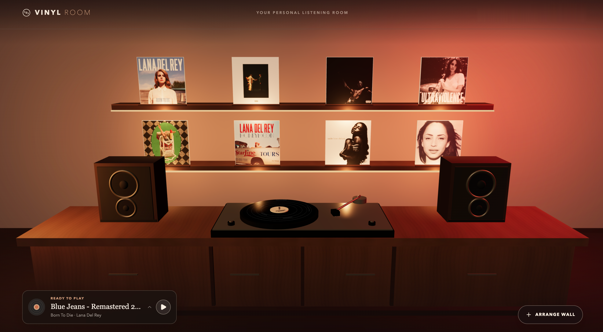

# Vinyl Room



Vinyl Room is a personal, interactive 3D listening room. Eight album spots sit above a wooden console and turntable in a fixed, single-screen view. Search Spotify's catalog to arrange your wall without saving albums to your Spotify library. Opening an album shows its tracks; music changes only when you select a track.



## Download for macOS

**Apple Silicon (M-series):** [Vinyl Room v0.5.0 DMG](https://github.com/Sissighn/vinyl-shop/releases/download/v0.5.0/Vinyl-Room-0.5.0-arm64.dmg). The download becomes available when the `v0.5.0` GitHub release is published. [View all releases](https://github.com/Sissighn/vinyl-shop/releases).

Open the DMG and drag **Vinyl Room** to Applications. The current release process produces an unsigned DMG until Apple signing credentials are configured. macOS may require you to approve an unsigned app in **System Settings → Privacy & Security**. The app itself works without Spotify for viewing and rearranging an existing wall; catalog search and playback require a Spotify connection.

### Spotify setup

1. Create your own app in the [Spotify Developer Dashboard](https://developer.spotify.com/dashboard) and choose **Web API**.
2. Add `http://127.0.0.1:17873/api/spotify/callback` as a Redirect URI. Use `127.0.0.1`, with the port and path shown here; `localhost` is not accepted by Spotify.
3. Paste the app's **Client ID** into Vinyl Room's first-launch setup. Do not enter a Client Secret. Sign-in opens in your default browser.
4. For playback, open the **Spotify desktop app on the same Mac** and briefly play a song so it appears as a Spotify Connect device. If Vinyl Room cannot find it, use **Refresh devices** in an album's track panel.

Vinyl Room controls the Spotify desktop app; protected audio is not streamed inside Electron. Playback requires Spotify Premium. Spotify development-mode apps require the app owner to have Premium and allow only accounts added to that app's user allowlist (up to five users for new apps). See [Spotify's development-mode rules](https://developer.spotify.com/documentation/web-api/concepts/quota-modes), [redirect URI rules](https://developer.spotify.com/documentation/web-api/concepts/redirect_uri), and [playback API](https://developer.spotify.com/documentation/web-api/reference/start-a-users-playback).

**Disconnect** removes Vinyl Room's local Spotify session, while your wall stays on this Mac. You can export the wall before clearing app data or moving to another Mac. Disconnecting Vinyl Room does not revoke access in your Spotify account settings.

## Use the room

- Click a wall album to browse its tracks. Click outside or press Escape to close the panel. Choosing another album does not interrupt the current song.
- Open **Arrange Wall**, select one of the eight spots, then search and add or replace an album. Results show ten albums per page. Remove an album or undo your last wall change from the same panel.
- Drag an album between spots to move or swap it. With a keyboard, focus a spot and press Space to pick it up, use the arrow keys to move, then press Enter or Space to drop. Escape cancels.
- Use **Export** and **Import** in **Arrange Wall** to back up or restore your wall as JSON. Changes are also saved locally.
- Click the tonearm or the compact player to pause or resume. Expand the player for seeking, previous/next, shuffle and repeat. The record's rotation follows Spotify playback state.

Album artwork and metadata come from Spotify, with links to the original albums and tracks. No covers are generated.

## Develop locally

Requires Node.js 22.13 or newer. The browser app and Mac app share the same React UI and Spotify routes; the desktop build bundles a local Next.js server inside Electron.

```bash
npm ci
cp .env.example .env.local
npm run dev
```

Open `http://127.0.0.1:5173`. For Spotify sign-in in the browser, add `http://127.0.0.1:5173/api/spotify/callback` to the same Spotify app, then fill in `SPOTIFY_CLIENT_ID` and `SPOTIFY_CLIENT_SECRET` in `.env.local`. The browser uses server-side HTTP-only cookies; the Mac app uses PKCE and needs only the Client ID.

Build and verify:

```bash
npm run lint
npm run typecheck
npm test
npm run build
npm run desktop:package
```

The local Apple Silicon DMG is written to `release/Vinyl-Room-0.5.0-arm64.dmg`. The `release/` directory is ignored by Git. The Electron window uses sandboxing, context isolation, restricted navigation, denied permissions and a content security policy.

## Release process

`package.json` is the version source. A Git tag must match it exactly, for example `v0.5.0` for version `0.5.0`. Run `npm run release:check` before making a release. After **you** commit and push the versioned source, push its matching tag. The [macOS release workflow](.github/workflows/release-macos.yml) runs the checks, builds the Apple Silicon DMG, verifies it, creates a SHA-256 checksum and publishes both files to GitHub Releases. It rejects a mismatched tag or incomplete signing configuration.

Without signing credentials, the workflow labels the release **unsigned and not notarized**. For a signed and notarized release, an Apple Developer Program account is required. Configure all six repository secrets: `MAC_CSC_LINK` (base64-encoded Developer ID Application `.p12`), `MAC_CSC_KEY_PASSWORD`, `APPLE_API_KEY` (base64-encoded App Store Connect `.p8`), `APPLE_API_KEY_ID`, `APPLE_API_ISSUER`, and `APPLE_TEAM_ID`. The separate [signed build configuration](desktop/electron-builder.signed.cjs) requires signing and notarization; it does not silently fall back to an unsigned build. See [electron-builder's notarization guide](https://www.electron.build/v26/docs/notarization/).

## Stack

React 19, TypeScript, Three.js, Next.js/Vinext, Electron, and the Spotify Web API. The 3D room updates changed sleeves in place and stops rendering when idle or hidden. The browser build uses Cloudflare/Vinext tooling; the Mac build uses Next.js standalone output.
